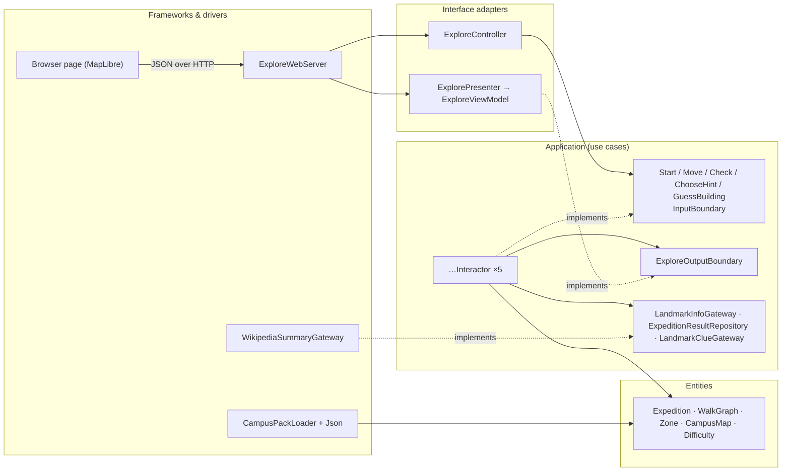

# Campus Hot & Cold

Java 21 / Swing geography game.

## Current status

- Start a round and Submit a guess use Clean Architecture input/output boundaries, controllers, interactors, presenters, and immutable view models.
- The core game supports six distinct guesses, written heat/trend feedback, wins/losses, answer reveal, and scoring. The UI does not receive the hidden target or exact distances during play.
- Finished rounds save locally. Open **History** to reopen a recap and view its answer or guesses on a browser map.
- **Explore mode** adds a two-stage 3D game in the browser: walk the real campus paths to find a hidden zone with limited hot/cold checks, then identify the building with a blind hint. See [Explore mode (3D)](#explore-mode-3d).

## Project domain

Educational geography game

Campus Hot & Cold is a Java geography game for Canadian university students. Choose a campus, then identify a secret landmark in six guesses. After each guess, get a hot/cold label and see whether you moved closer or farther away. The campus is known at the start, and a list of landmark names gives new players a way in. The 3D view would fly to the building you just guessed and fly to the secret landmark when the round ends.

## Minimum viable product

- One playable U of T St. George campus pack with 12 landmarks. A round offers up to six distinct guesses.
- Choose one secret landmark from the loaded campus. Show the candidate list, guesses remaining, and guess history. Reject repeated guesses without consuming a turn. End the round on a correct guess or after six valid guesses.
- Compute straight-line distance using the Haversine formula. For an initial St. George playtest, use four bands: hot under 100 m, warm under 250 m, cool under 500 m, and cold at 500 m or more. Show warmer, colder, or same based on the actual distance relative to the previous guess, treating a change under 1 m as the same. Show the trend even when the band stays the same. Show exact distances in the post-round recap.
- A win earns 7 minus the number of guesses used. An unsolved round earns zero. The improvement between guesses appears as feedback. A deliberate probe in the opposite direction can still help you narrow down the answer.
- A campus pack contains campus metadata and a curated list of Wikipedia article titles. Add Waterloo, UBC Vancouver, or McGill downtown by supplying another pack and checking that its coordinates and clue bands play well.

## User stories and proposed ownership

Planned use-case responsibilities are listed below. Implementation status is summarized above.

| Owner | Use case | User story | Completion check |
|---|---|---|---|
| Tony Yin | Start a round | As a player, I want to choose a campus so I can play somewhere I recognize. | Load the landmark list, pick a secret, and show six available guesses. Show a retry message if too few landmarks load. |
| Jinshi Li | Submit a guess | As a player, I want to know how warm my guess is and whether I got closer so I can narrow down the answer. | Score the distance, append feedback to history, and handle a win, a loss, and duplicates. |
| Takumi Goto | Review saved results | As a player, I want to review a completed round later so I can learn from my guesses. | Save completed rounds, reopen them after restarting, reveal the answer and ordered distances, and open a guessed/revealed location on a map. |

## Use-case specifications

### Start a round

- **Actor and trigger:** The player selects a campus and clicks Start round.
- **Precondition:** A campus pack is available.
- **Main flow:** The app loads the campus coordinates, chooses a secret landmark, and displays candidate landmarks and the guess limit.
- **Alternate flow:** If the API is unavailable or returns fewer than six eligible landmarks, the app displays a retry message.
- **Postcondition:** A fresh round is ready, with the target hidden.

### Submit a guess

- **Actor and trigger:** The player selects a candidate and clicks Guess.
- **Precondition:** A round is in progress.
- **Main flow:** The app records the guess, displays its heat and trend, and decrements guesses remaining.
- **Alternate flow:** A duplicate or invalid guess consumes no turn. A correct guess or the sixth valid guess ends the round.
- **Postcondition:** The guess appears in history and the round is updated.

### Explore a landmark

- **Actor and trigger:** The player clicks Open landmark on map.
- **Precondition:** At least one guess exists or the target has been revealed.
- **Main flow:** The app opens the latest guessed landmark or the revealed answer in a browser map.
- **Alternate flow:** If browser launch fails, the app displays an error.
- **Postcondition:** The round is unchanged.

### Review results

- **Actor and trigger:** The player completes a round.
- **Precondition:** The player solved the round or exhausted the guess limit.
- **Main flow:** The app reveals the answer, shows the score, and displays the distance for each guess.
- **Postcondition:** The recap remains visible until the player starts another round. Completed rounds are saved locally and can be reopened after restarting.

## Core entities

| Entity | Instance data | Relevant methods |
|---|---|---|
| `Campus` | Name and article titles | `name()`, `articleTitles()` |
| `Landmark` | Wikipedia page ID, name, latitude, longitude | `distanceTo(other)` |
| `Round` | Candidate landmarks, secret landmark, and ordered guesses. The guess limit is a class constant. | `submitGuess(id)`, `guessesRemaining()`, `isWon()`, `score()`, `revealedLandmark()` |
| `Guess` | Landmark, distance in metres, heat, and trend | `evaluate(landmark, target, previous)` and record accessors |


## External API and successful request

The Java gateway batches Wikipedia article titles using the [MediaWiki Action API](https://www.mediawiki.org/wiki/API:Geosearch/en). It requests primary Earth coordinates and follows article redirects. The coordinates drive distance feedback and map destinations. Loading takes place off Swing's event-dispatch thread. If fewer than six usable landmarks come back, the screen allows a retry.

```text
GET https://en.wikipedia.org/w/api.php
    ?action=query&prop=coordinates&redirects=1
    &coprimary=primary&colimit=max&format=xml
    &titles=Robarts%20Library%7CHart%20House%20(University%20of%20Toronto)
```

On November 13, 2026, the Java API check returned 12 landmarks from the full campus pack. Robarts Library returned latitude `43.664444` and longitude `-79.399444`. Convocation Hall resolved through a redirect.

Rechecked from Java on November 21, 2026: all 12 landmarks loaded successfully, including Robarts Library at `43.664444, -79.399444`. This execution environment required its normal HTTPS proxy and system certificate store; those environment-specific settings are not committed to the app.

## Run locally

Install **JDK 21** (not just a JRE) and Maven. Open `pom.xml` in IntelliJ as a Maven project, or run:

```sh
mvn verify
java -jar target/campus-hot-and-cold-0.2.0.jar
```

Without Maven, compile and run in a macOS, Linux, or Git Bash terminal:

```sh
mkdir -p out
javac -d out $(find src/main/java -name '*.java')
java -cp out campus.Main
```

Run `java -cp out campus.Main --check-api` to verify the live API and list the imported coordinates without opening Swing. The previous `campus.ui.CampusGame` entry point remains supported. Network access to Wikipedia is required to start a new round; failed loads show a retry message. No API key or billing account is required for the Wikipedia integration.

## Saved results and history

Complete a round to save its result automatically. **History** lists saved rounds newest first. Select a round and click **Open recap** to see the answer, score, and ordered distances. The recap offers map links for the answer and each guessed landmark. **Back to game** preserves the current round.

The app stores one versioned file per completed round in `~/.campus-hot-and-cold/rounds/`. If a save fails, the recap stays visible and **Retry save** uses the original result. Check that the storage directory is writable. If History names an unreadable file, restore it from backup or move it out of the rounds directory for inspection, then click **Reload**.

## Development and verification

Use feature branches and pull requests. GitHub Actions runs `mvn verify` under a virtual display on pushes and PRs, including desktop Swing integration tests. Each successful run provides a downloadable Java 21 JAR artifact. Tests use a fake gateway and a local HTTP server, so they run without Wikipedia access.

`campus.Main` is the composition root. Application/domain code has no Swing or infrastructure dependencies. Start output goes through the presenter into an immutable view model; the target stays inside `GameSession`/`Round` during play. Do not add credentials or API keys to this public repository.

## Explore mode (3D)

Explore is the two-stage version of the game, played in a pixel-art 3D model of a real campus. Run the app and click **Play Explore (3D)** in the launcher. It opens in your browser. **Classic mode** is the original six-guess game.

### Campuses and modes

- **University:** the start screen lists the campuses in `src/main/resources/campus/packs/index.json` (U of T St. George and UWaterloo). Each campus is a data pack; see *Development* below.
- **Daily:** everyone gets the same puzzle each day (same target, zone and start, in the Java app and on the website), always on normal difficulty, with **one try**. The day changes at midnight campus time. The puzzles are generated ahead in the campus pack. The one-try rule is per player device: the Java app keeps a marker in `~/.campus-hot-and-cold/daily/`, the website uses browser storage. After a round, **Share** copies a spoiler-free result (score, check colours, guesses).
- **Unlimited:** a fresh random round every time.

### What the player sees and does

**Stage 1: find the zone**
- You start somewhere on campus, 450–900 m from a hidden 90 m zone. You walk a third-person avatar along real campus paths: <kbd>W</kbd>/<kbd>↑</kbd> walks, <kbd>A</kbd>/<kbd>D</kbd> turns at path junctions (yellow arrows show where you'll go), <kbd>S</kbd> turns around, and <kbd>Shift</kbd> runs.
- Press <kbd>Space</kbd> to spend one of 6 temperature checks. You see **hot** (<150 m from the zone), **warm** (<300 m), **cool** (<500 m) or **cold**, and whether you're warmer or colder than at your last check. Each check leaves a coloured flag. The avatar has a 3 m radius: touching the zone edge counts, and a check there ends stage 1. With no checks left, your next check is a final search: touching the zone continues, anywhere else the round ends.
- <kbd>M</kbd> opens the campus map with your checks and trail; clicking a spot travels there, charged as the shortest walk (distance and time).
- Distance walked (including backtracking) and time are shown at all times.

**Stage 2: guess the building**
- The camera rises over the zone and its buildings light up; drag or use the arrow keys to look around. You pick one of three face-down hint cards: **easy ×1** (what anyone can see: height rank, storeys, facade, courtyard), **normal ×1.5** (what students know: its category and best-known fact) or **hard ×2** (campus history: an obscure historical fact). You only see the hint after choosing. Facts come from Wikipedia with the building's name blanked out.
- Hover a highlighted building to see its name, and click it to guess. You get 3 guesses.

**Results**
- The camera flies to the answer, which glows gold under a beacon. You see your score, the building's Wikipedia summary and photo (when it has an article), and a replay of your route drawn against the shortest walking route.
- **Score** (out of 1000) = route (400 at 80% efficiency or better; the shortest route assumes you already knew the zone) + identification (250 / 200 / 150 for a correct 1st / 2nd / 3rd guess) + hint bonus (+0% / +50% / +100% for easy / normal / hard) + checks saved (up to 100; the check that finds the zone is free).

The game never sends the hidden zone, the target or exact distances to the browser before the stage that reveals them. Moves are checked by Java for speed and path connectivity, so the page can't teleport or cut through buildings.

### APIs and data
| Source | What it provides | Where it's used | Why it fits |
|---|---|---|---|
| Wikipedia REST API `page/summary` | Title, intro extract, thumbnail and link for the revealed landmark | `WikipediaSummaryGateway` → `GuessBuildingInteractor` at the end of a round | Public, keyless, reliable descriptions for real campus buildings. Failures just hide the card. |
| MediaWiki Action API (`prop=coordinates`) | Landmark coordinates | Classic mode (`WikipediaLandmarkGateway`) | See *External API* above. |
| OpenStreetMap (via `tools/build_pack.py`) | Building outlines, heights and footpaths for curated landmarks | `src/main/resources/campus/packs/*.json`, loaded by `CampusPackLoader` | Accurate, openly licensed (ODbL) geometry. Curated offline so play needs no slow live queries. |
| OpenFreeMap vector tiles + MapLibre GL | Ground, roads and parks for the 3D view | Browser page only | Keyless and free. Rendered at low resolution for the pixel look. |

### Architecture



Dependencies point inward: entities import nothing from outer layers, and use cases see only ports. `campus.Main` is the only class that wires concrete classes.

**SOLID in practice**
- *Dependency inversion:* `GuessBuildingInteractor` depends on the `LandmarkInfoGateway` interface, not on HTTP. Tests pass a fake; `Main` passes the Wikipedia gateway.
- *Single responsibility:* rules live in `Expedition`, formatting in `ExplorePresenter`, input validation in `ExploreController`, and transport security in `ExploreWebServer`.
- *Interface segregation:* each use case has its own small input boundary, so the controller depends only on what each action needs.
- *Open/closed:* new difficulty presets, clue sources or result stores plug in through `Difficulty` and the ports without editing the interactors.

**Design patterns**
- *Null Object:* `LandmarkInfoGateway.NONE`, `ExpeditionResultRepository.DISABLED` and `LandmarkClueGateway.NONE` let the game run before optional features exist, without null checks.
- *Adapter:* the gateways adapt external services to the application's ports.
- *Strategy:* the hard hint takes an outside clue source as a function, so a different clue strategy (e.g. Wikipedia sentences) can be swapped in.

**Deliberate exceptions**
- `Expedition.zoneForDiagnostics()` exposes the hidden zone. The server only uses it when started with `-Dcampus.explore.debug=true`, so automated visual tests can walk to the zone.
- `ExploreController.handle` returns the presenter's view model so the web server can reply synchronously. The presenter still produces the data, and the controller doesn't format anything.

### Extension points left open
- `Difficulty`: only `NORMAL` exists. Add easy/hard presets and a selector on the start screen.
- `ExpeditionResultRepository`: finished rounds are passed to it, but the default doesn't save. Add a file-backed store and a history view.
- `LandmarkClueGateway`: hard hints can use a redacted encyclopedia sentence once a clue source is added.

### Development
- `mvn verify` runs all tests and Checkstyle (`checkstyle.xml`; the build fails on violations).
- For visual testing, run headless with a fixed port and debug info:
  `java -Djava.awt.headless=true -Dcampus.explore.port=8790 -Dcampus.explore.debug=true -jar target/campus-hot-and-cold-0.2.0.jar`,
  then open `http://127.0.0.1:8790/?debug=1`. Debug mode adds `game.debugWalkToZone()` in the browser console.
- `python3 tools/build_pack.py <buildings.json> src/main/resources/campus/packs/st-george.json [greenery.json]` regenerates the campus pack from Overpass exports. The curated landmark list is at the top of the script.
- **Adding a campus:** follow [`docs/ADD_A_CAMPUS.md`](docs/ADD_A_CAMPUS.md), a step-by-step prompt you can hand to a coding agent (or follow yourself).
- **Mascot per university:** each campus pack names the player's avatar in `MASCOT` (see `tools/build_pack.py`): a name, a body the page can draw (`beaver`, otherwise a student) and school colours. U of T plays as True Blue the beaver, an original pixel design in school colours. Change it for every university's pack.

## November 13 milestone

The starter includes the four domain entities, the Wikipedia gateway, the start-round interactor, and the Swing screen. A player can load the campus, play a full round, view the results, and open the most recent guess or revealed answer in a browser map. The 3D fly-to is proposed and depends on testing camera framing and imagery coverage on the selected campus.


## Core-game verification

The desktop integration suite clicks the actual Swing controls with deterministic landmark data. It checks a win, a six-guess loss, automatic saving, a failed-save retry, history after a fresh app session, map destinations, failed network loads, and starting another round. External browser launching is replaced by a recording gateway; the real map link still needs a browser on the player's computer.

On Linux, run all desktop tests with `xvfb-run -a mvn verify`. On a normal desktop, `mvn verify` includes them automatically. In headless environments without a display, desktop tests are skipped; the other tests still run. The integration tests do not access Wikipedia or modify real player history.

Classic mode covers one campus with browser map links. Explore mode adds the 3D campus; multiple campuses are a future extension.
