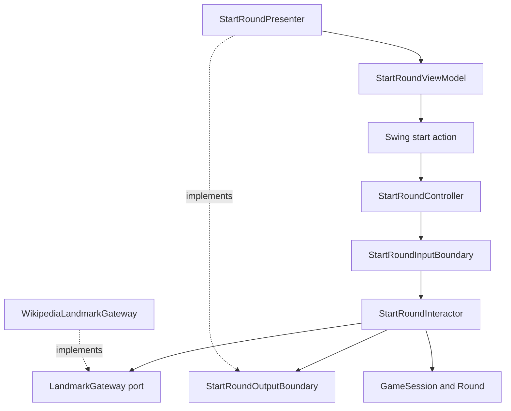

# Tony: Start a round

## Behavior

Selecting U of T St. George and pressing Start loads the curated Wikipedia article titles in one coordinate query. The HTTP gateway follows article redirects, uses primary Earth coordinates, deduplicates canonical page IDs, and sorts the landmarks. At least six distinct valid landmarks are required. The interactor selects one target uniformly, installs a fresh round, and presents candidate names with six guesses remaining. No secret target or coordinates are included in the start response.

The Swing screen disables conflicting controls during loading and updates widgets only after its worker completes. Network errors, insufficient/invalid data, and interruption produce a retry message. Failed loads leave the old round and guess history intact. Successful loads reset the dropdown and history and disable map viewing until a guess.

## Clean Architecture

`campus.Main` wires concrete dependencies. The controller depends on an input interface; the interactor depends on gateway/output interfaces. Formatting belongs to the presenter, HTTP/XML to the gateway, round invariants to the entities, and widget updates to Swing. No application/domain class imports Swing, adapters, or infrastructure.

## Tests

`StartRoundInteractorTest` covers the controller-to-presenter flow, fresh round state, exactly-six and too-few packs, API failures with and without an existing round, interruption, missing campus selection, duplicate canonical IDs, retry success, immutable output, hidden-target DTO shape, and deterministic target selection.

`WikipediaLandmarkGatewayTest` uses a local HTTP server rather than live Wikipedia. It checks query construction, primary Earth selection, sorting/deduplication, missing coordinates, HTTP/API failures, malformed XML, invalid coordinates, and rejected external entity documents.

The suite contains 20 JUnit tests. The live request is a separate check, never a deterministic unit-test dependency. A fresh Java `--check-api` request on November 21 loaded all 12 landmarks successfully. This environment required its normal HTTPS proxy and system certificate store; the source does not hard-code those runtime settings.

## Demo and explanation

1. Start a round; point to the loading message, candidate list, and six remaining guesses.
2. Explain how the HTTP gateway can be replaced by a fake without changing the use case.
3. Show `StartRoundResponse`: only campus name, candidate ID/name pairs, and guesses remaining.
4. Show the tests proving a failed load preserves the old round and a retry succeeds.
5. Describe the input/output boundaries and why `Main` owns dependency wiring.

The remaining guessing and results methods in Swing are starter code reserved for teammates to replace; this PR does not claim those flows fully adhere to Clean Architecture or that persistence is implemented.
